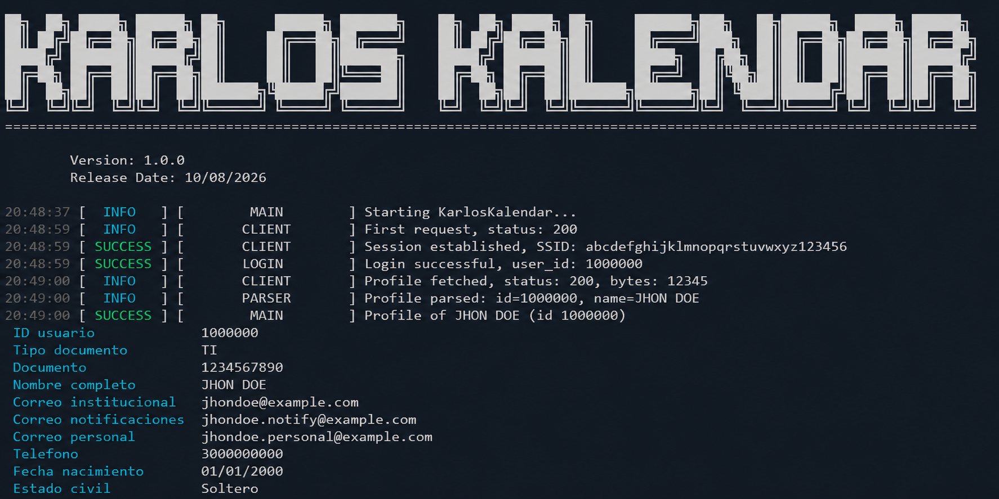

<h1 align="center">KarlosKalendar</h1>

<p align="center">
  <a href="https://www.python.org/"></a>
  <a href="https://git-scm.com/"></a>
  <a href="https://www.conventionalcommits.org/"></a>
</p>

<p align="center">
  <a href="README.md"><b>English</b></a> | <a href="README.es.md"><b>Español</b></a>
</p>


---


<p align="center">
  
</p>


<p align="center">
  CLI that monitors the academic agendas of the UNAD Campus Virtual<br>
  — scrapes them periodically and detects changes automatically.
</p>


---


## Table of Contents


- [Technologies and others](#technologies-and-others)
- [Structure](#structure)
- [Quick Start](#quick-start)
- [Configuration](#configuration)
- [Usage](#usage)
- [How it works](#how-it-works)

---


<div align="center">


## Technologies and others


### Build & Tooling


<p>
  <a href="https://git-scm.com/"></a>
  <a href="https://www.conventionalcommits.org/"></a>
</p>


### Backend


<p>
  <a href="https://www.python.org/"></a>
  <a href="https://requests.readthedocs.io/"></a>
  <a href="https://www.crummy.com/software/BeautifulSoup/"></a>
  <a href="https://rich.readthedocs.io/"></a>
  <a href="https://inquirerpy.readthedocs.io/"></a>
  <a href="https://pypi.org/project/colorama/"></a>
</p>


</div>


---

## Structure


```
KarlosKalendar/
├── core/
│   ├── client.py         # HTTP client: persistent session, xajax login
│   ├── parser.py         # User profile parsers (access page, profile page)
│   ├── scraper.py        # Agenda fetch, parse, JSON storage and change detection
│   └── xajax.py          # xajax request builder and response parser
├── schemas/
│   └── schemas.py        # Shared frozen dataclasses and type aliases
├── utils/
│   ├── config.py         # Configuration manager (config/config.json)
│   ├── config_menu.py    # Interactive configuration menu (InquirerPy)
│   ├── constants.py      # Global constants (URLs, headers, cookies)
│   ├── display.py        # Rich table rendering
│   ├── banner.py         # Banner of the app
│   └── log.py            # Tagged logger with level and tag filters
├── config/
│   └── config.json       # Runtime configuration (gitignored)
├── calendars/            # Scraped agenda data as JSON (gitignored)
├── .github/
│   └── preview.png       # Project preview image
├── .env                  # Credentials (gitignored)
├── .env.example          # Credentials template
├── main.py               # CLI entry point
├── requirements.txt
└── README.md
```


## Quick Start


Requirements: **Python 3.12+**


### 1. Clone and install


```bash
git clone https://github.com/Zerik-Official/KarlosKalendar.git
cd KarlosKalendar

# Windows
python -m venv venv

# Linux / macOS
python3 -m venv venv

# Windows
venv\Scripts\activate

# Linux / macOS
source venv/bin/activate

# Now, install the dependencies
pip install -r requirements.txt
```


### 2. Set up the credentials


```bash
cp .env.example .env
```


Edit `.env` and fill in your UNAD Campus Virtual credentials:

```
CC=ENTER_YOUR_ID
PASSWORD=ENTER_YOUR_PASSWORD
```


### 3. Register the calendars to monitor


```bash
# Windows
python main.py --config

# Linux / macOS
python3 main.py --config
```


Choose **Add calendar** and paste an agenda URL, for example:

```
https://datateca.unad.edu.co/contenidos/agendas/2026-2204/212014.htm
```


### 4. Run


```bash
# Windows
python main.py

# Linux / macOS
python3 main.py
```


## Configuration


The `--config` flag opens an interactive menu (InquirerPy) with the following options:

| Option | Description |
|--------|-------------|
| **Add calendar** | Registers a new agenda URL, validated against the `.../<code>.htm` format |
| **Remove calendars** | Unregisters one or more calendars (checkbox selection) |
| **List calendars** | Shows the registered calendars as a table |
| **Set scrape interval** | Changes how often the calendars are scraped (minutes) |
| **Exit** | Saves the configuration and closes the menu |


After adding a calendar, the menu offers to **scrape it now** so the first snapshot is stored immediately.


The configuration is persisted in `config/config.json` (gitignored):

```json
{
  "interval_minutes": 5,
  "calendars": [
    "https://datateca.unad.edu.co/contenidos/agendas/2026-2204/212014.htm"
  ]
}
```


## Usage


### Default mode


```bash
# Windows
python main.py

# Linux / macOS
python3 main.py
```


- Authenticates against the Campus Virtual portal with the credentials in `.env`
- Prints the user profile as a table
- Scrapes every registered calendar each cycle (default: every **5 minutes**)
- Compares each result with the stored JSON in `calendars/`
  - **No changes** → keeps the current file
  - **Changed** → updates the JSON automatically


Stop the loop with `Ctrl + C`.


### Interactive configuration mode


```bash
# Windows
python main.py --config

# Linux / macOS
python3 main.py --config
```


## How it works


1. **Login** — `core/client.py` establishes a persistent `requests.Session` against the campus endpoint and authenticates through the xajax login flow (`core/xajax.py`), capturing the `PHPSESSID` cookie.
2. **Scraping** — `core/scraper.py` fetches each agenda page with the authenticated session, extracts the course name, credits, academic period and every activity section (`75%`, `25%`, etc.), handling `rowspan` cells.
3. **Storage** — each agenda is saved as `calendars/<code>.json` (e.g. `212014.json`) with all activities and their dates (start, end, closing alert, feedback window).
4. **Change detection** — the newly parsed data is compared with the stored JSON; only when it differs the file is updated.